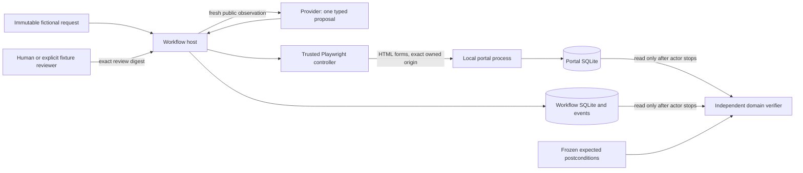

# Architecture and tradeoffs

This is one Python decision loop over an authored procurement portal. Playwright supplies DOM and accessible-state controls; it is not screenshot computer use. The default provider is a deterministic reactive policy. The optional Ollama transport is protocol-tested with local doubles and has no measured live-model result.

## Components and data flow

`backoffice/runner.py` constructs the provider context, validates its one-tool proposal, applies host budgets and checkpoints, and dispatches tools. `backoffice/browser.py` owns one headless page and request interception. `portal/server.py` is a separate owned process whose HTML forms and SQLite transactions implement the fictional business operation. `backoffice/store.py` owns workflow state, the exclusive run lock and ordered events. `evaluation/verify.py` imports no acting logic and reads the two databases independently.

The public provider context contains schema version, the six request values, state, a fresh observation, remaining steps and the prior typed tool result. Observations contain URL/title, bounded ARIA text, visible enabled controls with ephemeral references, roles, labels, displayed values/options and visible records. They omit approval records, CSRF/cookies, filesystem/database paths, expected outcomes and fixture settings. Page text is untrusted evidence. The provider has no shell, file, SQL, HTTP, arbitrary JavaScript, free-navigation or approval-writing tool.

The controller's fixed DOM extraction is trusted implementation code. References must exist in the current observation, and the controller rechecks its DOM/control fingerprint before using them. It rejects ambiguous accessible controls. Values come from the immutable host request, never from a proposed free-text value; choices must match observed options. Popups, service workers, downloads, WebSockets and requests outside the exact owned loopback origin are restricted. This is an application request boundary, not an OS/network sandbox.

## Approval and write authority

The six fields are legal name, registration reference, country, contact email, category and payment terms. `ReviewV1` also binds task ID, request hash, action, draft ID, revision and public session ID. Manual CLI approval requires the full displayed SHA-256 digest. The external fixture reviewer grants or denies explicitly; the provider cannot write an approval.

Before consuming approval the host reloads the actual review page and compares every value/identity, the digest and expiry. It then persists consumed approval and commit intent. The controller reads the fixed final HTML form, including hidden CSRF and draft metadata, arms an exact-body ticket and waits for navigation. At the actual POST interception boundary it checks the body, digest, state, consumption, expiry, cancellation and persistent dispatch flag. It consumes/persists dispatch before forwarding. A generic submit click, changed body or second dispatch is blocked before the portal receives it.

The portal separately checks local origin/session/CSRF, exact draft revision and values, and unique registration reference. Vendor creation and its audit record commit together. These are authored portal guarantees, separate from the agent's visible-state reasoning. At-most-one attempted request per approval plus portal uniqueness does not establish exactly-once behavior on arbitrary websites.

## Persistence and recovery

```mermaid
stateDiagram-v2
  [*] --> CREATED
  CREATED --> AWAITING_APPROVAL: observe, search, fill, review
  AWAITING_APPROVAL --> APPROVED: external exact approval
  APPROVED --> SUBMITTING: reload review, consume intent
  SUBMITTING --> RECONCILING: commit response returned
  SUBMITTING --> INTERRUPTED: response unavailable or named barrier
  CREATED --> INTERRUPTED: orderly pre-review barrier
  INTERRUPTED --> RECONCILING: consumed intent; fresh runner
  INTERRUPTED --> CREATED: precommit checkpoint restoration
  RECONCILING --> ACTOR_DONE: exact visible detail record
  RECONCILING --> HANDOFF: missing/conflicting/uncertain outcome
  CREATED --> ACTOR_DONE: exact existing search record
  APPROVED --> HANDOFF: stale or expired authority
  CREATED --> HANDOFF: unsupported UI or conflict
```

Failure/cancellation states can stop any active phase. `ACTOR_DONE` is a claim; final success still requires the independent database verifier. Terminal replay starts no browser. The schema version and immutable request hash are checked on load. SQLite saves run state and the corresponding ordered event together; JSONL export is derived evidence, not the recovery authority. The exclusive lock prevents two active owners, and ports can change when the local portal is recreated because approvals bind public session identity rather than port.

After any consumed intent, a new runner performs visible UI search by registration reference and opens the matching detail page. It compares all six values and never starts another draft or resubmits. No visible row still causes uncertainty handoff: absence is insufficient authority to resend. Pre-review orderly interruption restores its checkpoint and obtains a fresh review. One automatic fictional reauthentication is allowed before approval; a lost session after approval invalidates that approval.

Executed recovery tests raise a named `Interrupted` exception or close the response socket after an atomic portal commit, unwind owned contexts, and create a new runner/portal/browser. They do **not** abruptly kill the operating-system process. Abrupt OS termination or power loss is untested; it may leave `run.lock`, an outdated cookie export or an owned process. There is no automatic stale-lock stealing. An operator must inspect ownership/process state and preserve evidence before any manual recovery. The project makes no general crash-durability claim.

## Evaluation separation

The external harness supplies authored fixture configuration and reviewer decisions. Its named barriers mutate/restart fixtures outside acting tools. The provider sees no case ID, barrier flag or expected result. `evaluation/verify.py` compares all rows, preserved prior rows, exact expected values, unique references, portal creation/POST counts and prior matching approval/intent/dispatch evidence. It opens SQLite in read-only mode; a success banner cannot override a missing or altered row.

The original M2 freeze covers 32 code/input/definition/dependency files. M3 utilities live in `acceptance/` so original policy, evaluator and case hashes stay unchanged. `acceptance/checkpoint.py` adds a separate hash checkpoint for these utilities/tests; it references the original freeze and cannot replace it. `acceptance/stress.py` executes the published six recovery cases three times in fixed order: eighteen runs, six distinct cases. `acceptance/audit.py` reinspects sixty comparison and eighteen repeat task directories against frozen oracles and rejects missing, duplicate, reordered or forged report entries. `acceptance/sensitivity.py` corrupts isolated copies to test fifteen verifier failure modes while preserving the source evidence.

Development is ten authored cases per approach. Held-out is thirty new fictional values/combinations: nineteen create, two exact-existing and nine unchanged handoffs. The same author knows the families and the support vocabulary. The fixed macro shares requests, budgets, review/POST gate, portal guarantees and verifier; it follows canonical labels/order and has no adaptation/restart policy. Baseline failures remain in their denominator, and baseline improvement is not an acceptance gate. The M3 worker evaluation produced reactive 30/30 and macro 3/30, all sixty safe, plus eighteen successful recovery repeats. The retained-evidence audit passed 546 conditions across 78 tasks and all fifteen copied-run corruptions were rejected. No frozen source or case changed after scoring. These local scripted results passed final independent fresh-source acceptance (18 commands and 1,019 direct conditions) and do not measure model quality.

## Chosen tradeoffs

| Choice | Benefit and limit |
| --- | --- |
| One host loop and stdlib persistence/HTTP | Few moving parts and clear authority; no distributed scheduler or enterprise session infrastructure |
| Python 3.11 and pinned Playwright shell | Direct browser workflow on Windows/Linux; package/hash compatibility does not prove hosted CI execution |
| Accessible DOM and published labels | Reviewable deterministic actions and bounded variations; no arbitrary-site or linguistic-generalization claim |
| Exact portal review contract | Strong six-field authority on this fixture; adapting a different portal requires a new trusted contract |
| UI-only uncertain-write reconciliation | Provider cannot infer safe resubmission from missing response; some recoverable absences become conservative handoffs |
| SQLite plus exclusive ownership | Ordered local checkpoints and uniqueness; abrupt-process recovery and multi-host concurrency are excluded |
| Independent final-state verifier | Detects false claims and wrong records; local users share filesystem privileges and can alter evidence |
| Scripted offline comparison | Reproducible integration evidence without weights/credentials/cost; no live-model quality or production adoption result |

## Contribution and scope

The contribution is a procurement task's exact approval/POST boundary, bounded UI reconciliation and independent outcome/evidence contract. It is not a general browser-agent library. Browser Use and WebArena are cited prior art; their upstream code, data and scores are not reused. All portal content, requests, variants, adversarial text and fixtures are authored under MIT. Real procurement, enterprise authentication, remote services, arbitrary websites, screenshot control, automatic model installation and deployment are excluded.
